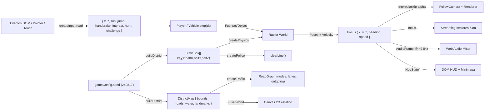

# Flujo de Datos (`DATA_FLOW.md`)

## Contratos principales de datos
1. **`MovementInput` / `read()` (`core/input.ts`):** Ejes `x, z ∈ {-1, 0, 1}`, flags mantenidos (`run`, `handbrake`) y acciones de un solo pulso consumidas al leer (`jump`, `interact`, `horn`, `challenge`).
2. **`StaticBox` (`physics/physics.ts`):** Caja alineada a ejes por centro `(x, y, z)` y semiextensiones `(halfX, halfY, halfZ)`.
3. **`DistrictMap` (`world/generation/layout.ts`):** Rectángulos de calles/agua, límites y pines de interés compartidos entre grafo vial y minimapa.
4. **`ContactShadowSource` (`renderer/postprocessing/contact-shadows.ts`):** Hasta 10 elementos con `(x, y, z, radiusX, radiusZ, heading?)`.
5. **`HudState` (`ui/ui.ts`):** `{ x, z, heading, hour, health, driving, canInteract, speed, wanted, policeStatus }`.
6. **`AudioFrame` (`audio/audio.ts`):** Muestreado cada `0.042 s` (~24 Hz) en `frame()`, incluye posición del oyente, velocidad, `coastDistance`, `police[]` y `traffic[]`.
7. **Persistencia (`persistence/preferences.ts`):** Claves `'quality'` (`Quality`) y `'audio'` (`{ volume, muted }`) en almacén `'preferences'` de IndexedDB `'viceblock'` v1. Estado de partida (posición, salud, hora, estrellas) es efímero en memoria.
