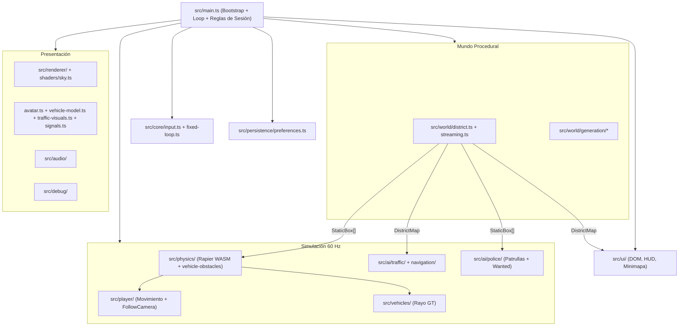

# Visión General de Arquitectura (`OVERVIEW.md`)

## Patrón arquitectónico real
**Arquitectura modular funcional con orquestador centralizado (`src/main.ts`).** Cada subsistema se crea mediante una función fábrica (`create*` / `build*`) que encapsula su estado en un *closure* privado y expone una interfaz reducida (`step`, `update`, `render`, `dispose`). No existe un framework ECS ni un bus de eventos global; `main.ts` conecta directamente los módulos.

## Límites entre componentes y separación de responsabilidades
- **Lógica vs. UI (`src/ui/`):** Separación limpia. `ui.ts` no importa física, mundo ni renderizador; solo recibe `HudState`/`DistrictMap` y dispara callbacks (`onPlay`, `onPause`, `onQuality`, `onHour`, `onVolume`, `onReset`).
- **Simulación vs. Render (`FixedLoop` vs `rAF`):** Las entidades de simulación guardan estado actual y anterior para interpolar con `alpha` dentro de `render()`.
- **Fronteras frágiles actuales (donde tener cuidado al modificar):**
  1. `src/main.ts` mezcla ciclo, daño/salud, obstáculos de tráfico y prioridad de sombras.
  2. `world.step()` vive dentro de `player` (`physics.ts`) y `vehicle.ts`, obligando a mantener exclusividad mutua entre ambos (`VB-001`).
  3. `vehicle.render()` debe ejecutarse antes que `player.render()` para que la cámara lea la pose interpolada del coche en el mismo frame (`VB-012`).
  4. `coast.ts` busca la luz solar dinámicamente en `scene.children` (`isDirectionalLight`).
