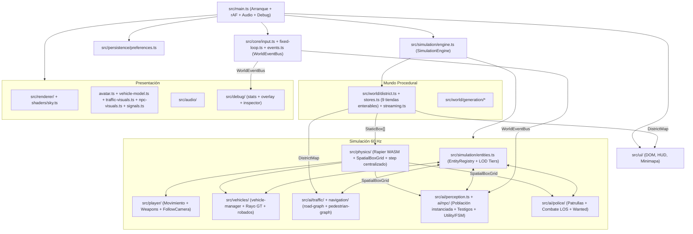

# Visión General de Arquitectura (`OVERVIEW.md`)

## Patrón arquitectónico real
**Arquitectura modular funcional con orquestador separado en `SimulationEngine` (`src/simulation/engine.ts`), bus de eventos espacial (`WorldEventBus`) y registro de entidades (`EntityRegistry`).** `src/main.ts` queda limitado a arranque, bucle `rAF`, UI, audio y herramientas de diagnóstico; cada tick fijo (`60 Hz`) ejecuta una única llamada centralizada `physics.step(dt)`.

## Límites entre componentes y separación de responsabilidades
- **Lógica vs. UI (`src/ui/`):** Separación limpia. `ui.ts` no importa física, mundo ni renderizador; recibe `HudState`/`DistrictMap` y el prompt ya calculado en `SimulationEngine.getInteractionPrompt()`.
- **Arranque vs. Simulación (`main.ts` vs `simulation/engine.ts`):** `SimulationEngine` encapsula toda la lógica de mundo sin depender de DOM, audio o canvas WebGL, permitiendo ejecutar pruebas de integración completas headless.
- **No omnisciencia de eventos:** `WorldEventBus` acota eventos por radio y TTL; los observadores filtran mediante `evaluatePerception` (FOV + `SpatialBoxGrid.clearLine` a altura ocular `1.15 m` + atenuación acústica).
- **Fronteras todavía sensibles:**
  1. `vehicle.render()` debe ejecutarse antes que `player.render()` dentro de `engine.render()` para leer la pose interpolada del coche (`VB-012`).
  2. `coast.ts` busca la luz solar dinámicamente en `scene.children`.

