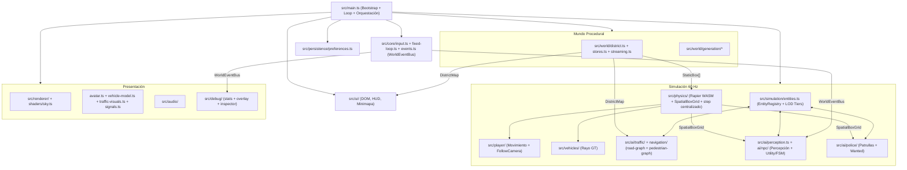

# Visión General de Arquitectura (`OVERVIEW.md`)

## Patrón arquitectónico real
**Arquitectura modular funcional con orquestador (`src/main.ts`), bus de eventos espacial (`WorldEventBus`) y registro de entidades (`EntityRegistry`).** Cada subsistema se crea mediante una función fábrica (`create*` / `build*`) o clase focalizada (`FixedLoop`, `SpatialBoxGrid`) y avanza a paso fijo de `60 Hz` con `physics.step(dt)` centralizado.

## Límites entre componentes y separación de responsabilidades
- **Lógica vs. UI (`src/ui/`):** Separación limpia. `ui.ts` no importa física, mundo ni renderizador; solo recibe `HudState`/`DistrictMap` y dispara callbacks.
- **Simulación vs. Render (`FixedLoop` vs `rAF`):** Las entidades guardan estado actual/anterior e interpolan con `alpha`. `physics.step(dt)` se ejecuta una única vez por tick fijo (`VB-001` resuelto).
- **No omnisciencia de eventos:** `WorldEventBus` acota eventos por radio y TTL; los observadores deben filtrar mediante `evaluatePerception` (FOV + `SpatialBoxGrid.clearLine` + atenuación acústica).
- **Fronteras todavía sensibles:**
  1. `src/main.ts` aún concentra reglas de sesión/salud; su extracción a `SimulationEngine` queda para consolidación posterior.
  2. `vehicle.render()` debe ejecutarse antes que `player.render()` para que la cámara lea la pose interpolada del coche (`VB-012`).
  3. `coast.ts` busca la luz solar dinámicamente en `scene.children`.
